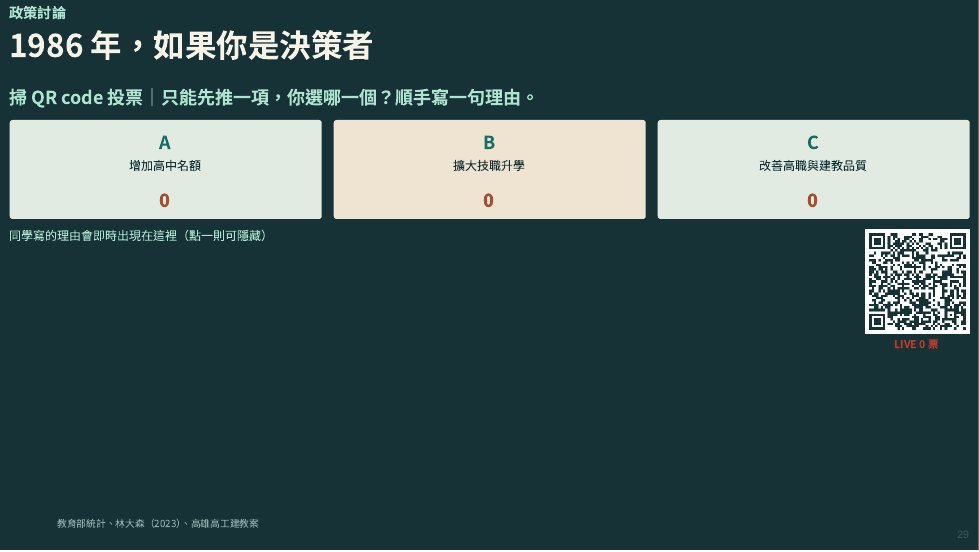
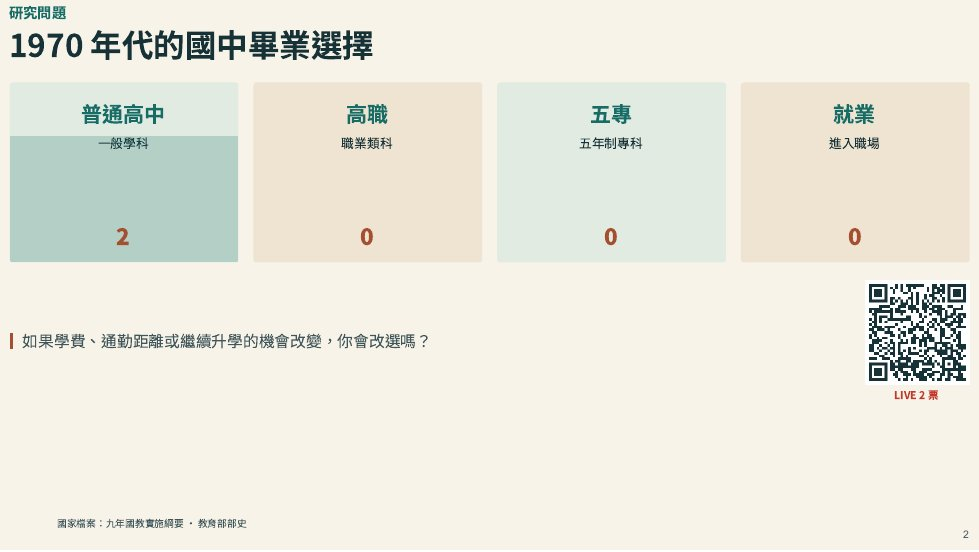
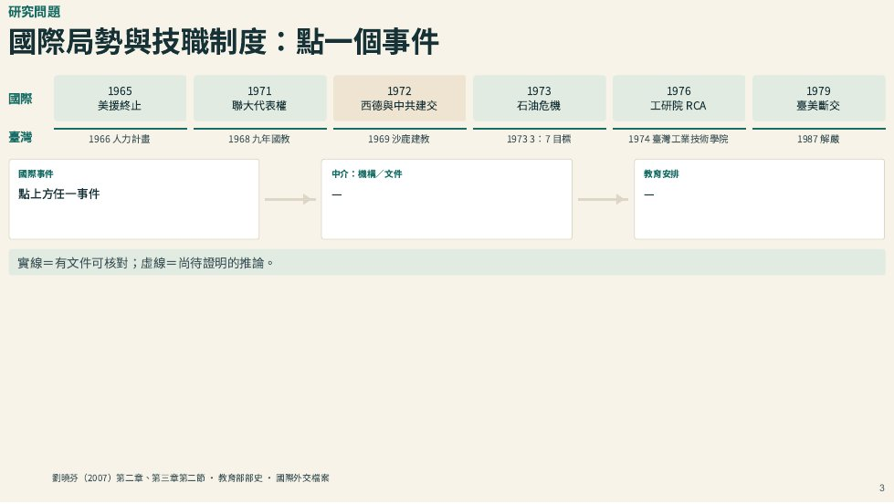
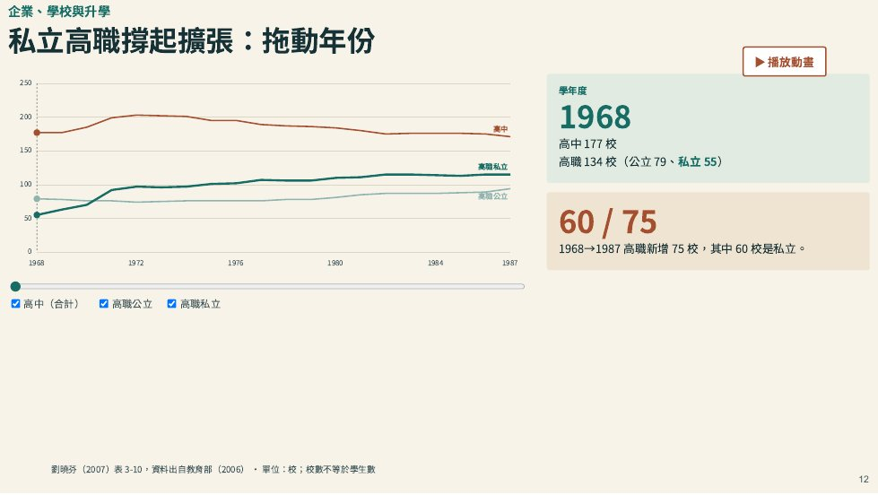
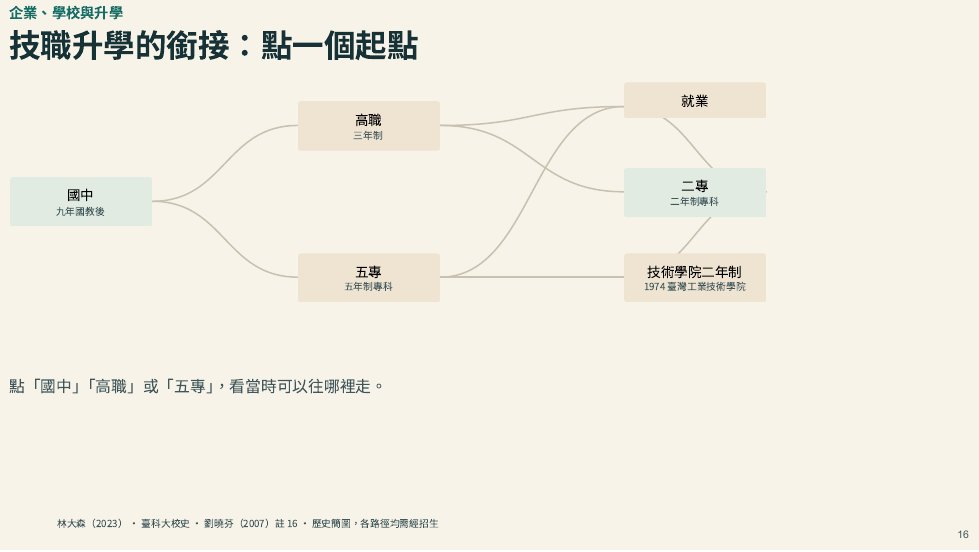
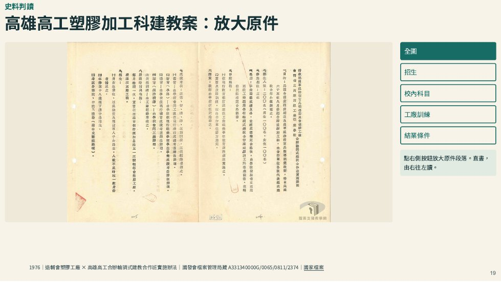
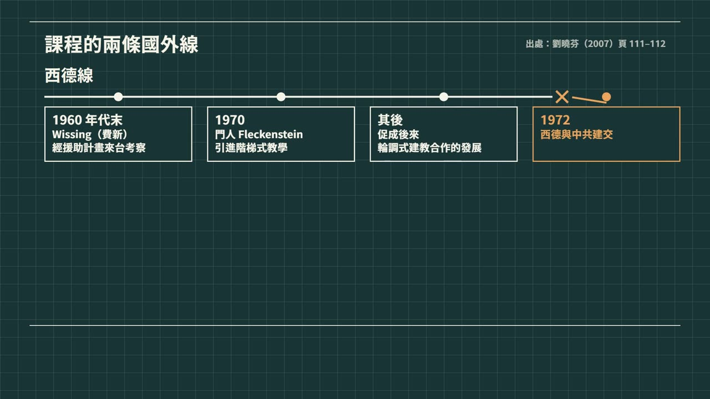
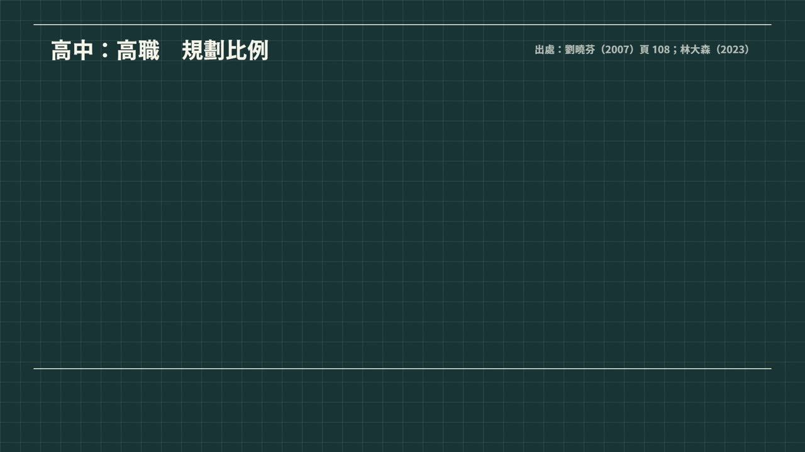

# 把一份課堂 PPT，做成會互動、有 AI 旁白的網頁教材

**[▶ 線上展示](https://jackyliao31-ops.github.io/tve-history-interactive-deck/)**　｜　**[手機投票頁](https://jackyliao31-ops.github.io/tve-history-interactive-deck/vote.html)**　｜　作者：廖常智（國立臺北科技大學 技術及職業教育研究所）



## 30 秒看懂這個作品

研究所課堂報告原本只有一份靜態 PPT。我把它重新設計成上課可以直接使用的網頁教材：

- 學生用手機掃 QR code 投票、寫理由，結果即時出現在投影幕上。
- 統計圖可以拖、可以切換，史料原件可以點開放大判讀。
- 重點段落配上 AI 產生的解說動畫，旁白用我自己的聲音複製錄製。

報告的主題是臺灣技職教育史，**但這份作品集要展示的是做法**：怎麼把教學目標轉成互動設計，再用生成式 AI 加快教材產製，同時把品質把關好。

| 32 頁 | 10 餘種互動元件 | 2 題即時投票 | 4 段 AI 解說動畫 | 0 建置工具 |
|:-:|:-:|:-:|:-:|:-:|
| 網頁簡報 | 滑桿、切換、拖曳、放大 | Firebase 即時同步 | 含 118 秒 AI 語音旁白 | 純 HTML/JS，離線可開 |

---

## 這個作品展現的能力

### 1. 教學設計轉成互動設計（教育科技）
每個互動元件都對應一個學習目標，不是為了炫技：

| 學習目標 | 互動設計 | 對應的教育科技概念 |
|---|---|---|
| 讓每位學生都表態，不只是少數人發言 | 手機掃碼投票，長條圖即時更新 | 即時回饋系統（CRS）、主動學習 |
| 讓推理過程被看見 | 投票時附一句理由，理由即時上牆；講者可隱藏不當留言 | 論證外顯化、同儕學習、內容管理 |
| 區分「有證據」與「推論」 | 點國際事件，展開「事件 → 中介 → 教育結果」證據鏈，實線與虛線分開 | 歷史思維、證據推理、鷹架 |
| 理解統計數字的口徑 | 切換分母，比較 68.6% 與 72.5% 為什麼不同 | 可操作的資料視覺化、統計素養 |
| 看見長期變化 | 拖動年份滑桿，看公私立高職校數消長 | 探索式學習 |
| 讀懂原始史料 | 1976 年建教合作原件，點熱點放大條文 | 原始史料判讀 |
| 檢核理解程度 | 把卡片拖進「文件明定」或「仍需追蹤」 | 形成性評量 |
| 降低認知負荷 | 重點頁嵌入動態圖解，旁白與字幕同步 | 多媒體學習原則、雙通道處理 |

### 2. 生成式 AI 應用：AI 負責產出，我負責判斷
這個專案的開發過程，就是一次完整的「人機協作」流程：

| 階段 | AI 做的事 | 我做的判斷 |
|---|---|---|
| 內容整理 | 讀專書章節、他組報告、組員大綱，整理出缺口 | 決定補哪一節、哪些史料互相矛盾需要標註 |
| 程式開發 | 與 AI 程式助理 Claude Code 協作，寫出互動元件與投票系統 | 定義每個元件的教學目的、驗收畫面與流程 |
| 解說動畫 | 依腳本與分鏡產生動畫（HyperFrames，用 HTML 寫動畫再渲染成 MP4） | 審稿、修正畫面上的年份與用詞 |
| AI 旁白 | 用 VoxCPM2 複製我自己的聲音，產生五段旁白 | 試聽語氣與發音，逐段伸縮對齊字幕時間軸 |
| 事實查核 | — | 發現文獻把西德與中共建交誤記為 1971 年（實為 1972 年），簡報、動畫畫面與 AI 旁白一併重做 |

**AI 素養重點：** AI 讓產製速度大幅提高，但事實正確性、教學目的和倫理界線（例如只複製自己的聲音、留言可隱藏、不收集姓名）都要由人來把關。

### 3. 能上線運作的系統，而不只是設計稿
- **即時資料：** Firebase Firestore 的 `onSnapshot` 讓幾十支手機同時投票，投影幕當場更新。
- **資安設計：** Firestore Security Rules 只允許新增、不能修改或刪除，選項用白名單，理由限 60 字（[規則片段](firebase/firestore-rules-snippet.txt)）。
- **教室現場的容錯：** 網路斷線時，投票自動改成講者端本機計數。
- **部署：** 上課版放 Firebase Hosting，作品集版放 GitHub Pages。

---

## 作品截圖

| | |
|:-:|:-:|
|  |  |
| 開場：手機即時投票 | 點國際事件，展開證據鏈 |
|  |  |
| 拖動年份，看公私立高職消長 | 點起點，顯示可走的升學路徑 |
|  |  |
| 1976 年史料原件，點熱點放大 | 嵌在投影片中的解說動畫 |
|  |  |
| 118 秒回顧影片（AI 語音複製旁白） | 投票加理由牆 |

## 技術

| 用途 | 工具 |
|---|---|
| 網頁簡報 | Reveal.js 5.1（放在本機 `lib/`，離線也能開） |
| 互動與圖表 | 原生 JavaScript 與 SVG，不需要建置工具 |
| 即時投票 | Firebase Firestore、Security Rules |
| 解說動畫 | HyperFrames（HTML → MP4），字幕逐句對齊 |
| AI 旁白 | VoxCPM2 本機語音複製；ffmpeg rubberband 逐段對齊時間軸，響度正規化到 −14 LUFS |
| PPT 版本 | python-pptx 自動改版並嵌入動畫 |
| 開發協作 | Claude Code |

## 自己試試看

- 方向鍵換頁，`S` 開講者備註（含完整出處），`F` 全螢幕，`Esc` 總覽。
- 用手機開 [投票頁](https://jackyliao31-ops.github.io/tve-history-interactive-deck/vote.html)，送出後切回簡報第 2 頁或第 29 頁，看結果即時更新。
- 想自己部署投票功能：把 `live.js`、`vote.html` 裡的 Firebase 設定換成自己的專案，並套用 `firebase/` 裡的規則。

```
index.html    簡報本體（32 頁）        live.js     Firebase 即時投票與理由牆
app.js        時間軸、圖表、滑桿、QR    vote.html   學生手機端投票頁
interact.js   學制圖、路徑圖、史料、卡片  media/      AI 解說動畫（MP4）
```

## 關於我

廖常智，國立臺北科技大學技術及職業教育研究所碩士生。研究方向是**多模態生成式 AI 在教學評量的應用**：用 Gemini 評分職前教保人員的試教影片，探討人機評分一致性，以及評分規準與 AI 系統的調校。我關注的是怎麼讓 AI 真正進到教學現場，同時守住教學品質與評量信度。

---

<sub>史料圖片取自國家發展委員會檔案管理局等公開來源，出處列在各頁與講者備註。投票題的情境是教學設計，不是史實。本作品原為小組課堂報告（2026.11.18），作品集版本由廖常智整理。</sub>
